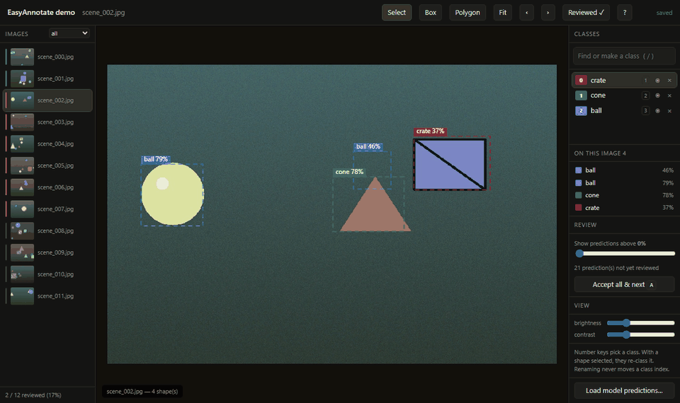

# EasyAnnotate



**Image annotation with nothing to set up.** Open a folder, draw a box, type a
class name — that is the whole workflow. Load a model's predictions and review
them at a few images a minute. Export a dataset that is correct by construction.

```bash
pip install easyannotate
easyannotate demo                  # a sample project opens in your browser
easyannotate annotate ./my-images  # your own folder: labels are written in place
easyannotate app                   # or a desktop window, with an Open-folder button
```

Or download the desktop app for Windows, macOS or Linux from the
[releases page](https://github.com/shivpratapsinghpanwar/EasyAnnotate/releases) —
no Python needed.

No account, no server, no Docker, no project template, no label schema. Your
images never leave your machine. Python 3.12+, Windows, macOS and Linux.

*Author: Shivpratap Singh Panwar.*

---

## Why this exists

CVAT makes you create an organisation, then a project, then labels, then a task
and jobs before you can draw one box. Label Studio wants a labelling config.
Roboflow wants your images in its cloud. EasyAnnotate's rule, which every
feature is subordinate to:

> **If a feature requires you to configure something before you can draw a
> box, it does not ship.**

What you get instead:

- **A class is created by using it.** Draw, type a name, Enter. Typing `open`
  when `Open` exists picks `Open` — the `Close/close` split that ruins real
  datasets cannot happen by accident.
- **No Save button.** Edits are saved 400ms after you stop and before you
  navigate. Reopening a project resumes on the first unfinished image.
  **Export…** downloads the dataset in any format, from the editor.
- **The model loop is the product.** Import predictions from any YOLO, COCO,
  VOC or LabelMe run; they arrive dashed with a confidence slider; `A` accepts
  an image. An agreement figure tells you when to retrain and when to stop.
- **Exports are correct.** YOLO class indices never move when you rename or
  retire a class. Export defaults to reviewed images only, so unreviewed model
  output can never silently become training data.
- **Five shape kinds, every format.** Boxes, polygons, rotated boxes, lines
  and points. Rotated boxes export as YOLO-OBB and DOTA, points as COCO
  keypoints, everything to LabelMe — and a dataset of any of them still comes
  out as plain boxes when a detector wants boxes.
- **AI assist that feeds the review loop.** `easyannotate tools install`
  adds SAM 2 (drag a box or click: an editable outline) and text-prompted
  detection: type `handle`, and every handle on every unreviewed image
  arrives as a prediction to review, dashed, with a confidence slider and one
  key to accept. The models run in their own environment, so the editor's
  install never depends on PyTorch, and without them it works unchanged.
- **Dataset tooling built in.** 28 operations — convert between five formats,
  find duplicates and train/val leakage, health reports, augmentation that
  moves the labels with the pixels — one `pip install` away.

---

## One core, four front ends

The original `Power_tools/` folder held fifteen scripts. Each hardcoded its
paths at the top, each re-implemented "find the image that matches this XML",
and they had quietly drifted apart — one moved sidecar labels alongside
duplicates, another had that code commented out. Same job, different answers.

Everything here runs through one core. Pairing an image with its label, moving
annotations when the pixels move, previewing before writing, and recording what
happened are solved once, so no operation can forget them.

```
data_factory/
  core/            pure logic — no printing, no argparse, no hardcoded paths
    types.py         OpResult / FileAction / Context (progress + cancellation)
    registry.py      every operation declares its own parameters
    pairs.py         the image + sidecar abstraction all 15 scripts re-invented
    fs.py            the single choke point every file mutation passes through
    imaging.py       image I/O, and geometry that moves annotations with pixels
    writer.py        streaming dataset writer, so augmentation is not memory-bound
    stats.py         dataset measurement, and the judgements drawn from it
    parallel.py      ordered parallel map for the decode-bound stages
    provenance.py    per-dataset lineage, recorded automatically
    bktree.py        metric tree behind fast perceptual matching
    annotations/     neutral model + VOC / YOLO / COCO / LabelMe / CSV
    ops/             the operations themselves
  cli/             argparse commands, interactive menu, terminal rendering
  pipeline.py      YAML/JSON recipes
```

An operation declares its parameters **once**. The CLI subcommand, the menu
prompts, the recipe validator and the web form schema are all generated from
that declaration — adding an operation means writing one file, and it appears
everywhere.

---

## Install

```bash
pip install easyannotate                 # everything: editor, CLI, service
uv tool install easyannotate             # isolated, on PATH
uvx easyannotate demo                    # run once, install nothing
```

Python 3.12+. Needs only numpy, Pillow, OpenCV, imagehash, PyYAML and FastAPI —
deliberately no PyTorch, so it installs in seconds anywhere.

**OpenCV is the headless build by default.** The ordinary `opencv-python` wheel
links against `libGL.so.1`, which slim containers, Cloud Run and most CI images
do not have — it installs fine and then throws `ImportError` on exactly the
machines a backend runs on. Only `collect.webcam`'s preview needs a GUI, and it
falls back to timer capture with a warning. For the preview:
`pip install "easyannotate[gui]"`.

There is deliberately no `sam` extra. Model-backed tools run in a **separate
process with their own interpreter**, discovered at runtime and absent without
complaint — so torch's version matrix never has to agree with this package's.
Point `DATAFACTORY_TOOLS_MODULE` at one to enable it; with none installed,
`GET /api/tools` returns an empty list and the editor is fully usable.

The Python package is `data_factory`, and `easyannotate` still works as a
command — the tool was named EasyAnnotate before the editor became the point.

---

## Four ways to drive it

**1. Interactive menu** — run it bare. Every path is a prompt, and destructive
operations preview before they ask.

```bash
easyannotate
```

**2. Command line** — for scripting and repeatability.

```bash
easyannotate list                          # every operation
easyannotate explain augment.dataset       # full help for one

easyannotate convert.detect --folder ./mystery-dataset
easyannotate inspect.health --folder ./data
easyannotate convert.dataset --folder ./voc --output ./yolo --to yolo
easyannotate augment.dataset --folder ./train --output ./aug --multiplier 3 --dry-run
```

**3. Recipes** — a dataset build written down, so it is reproducible.

```bash
easyannotate run recipes/train_ready_yolo.yaml --set root=D:/data --set out=D:/build
```

**4. Browser** — a local web interface, which doubles as the desktop app.

```bash
easyannotate serve                 # opens http://localhost:8765
```

Drop in a zip, it detects the format, and every operation appears as a form
generated from the same declaration the CLI reads. Binds to `127.0.0.1` only.
The same code hosts the service — see [DEPLOYING.md](DEPLOYING.md).

---

## Annotating

`easyannotate serve`, drop in a folder, click **Start annotating**. That is the
whole setup. There is no organisation to create, no project template, no task,
no label schema — **a class is created by drawing a box and typing its name.**

```
drag              draw a box in the current class -- inside other boxes too
click             select a shape; drag it to move, its handles to resize
/                 find a class by typing (never makes a Close/close variant)
P                 polygon: click points, Enter or double-click to close
O                 rotated box: drag, then turn it by its handle, or [ and ]
L  K              line: click points, Enter  ·  point: one click
1–0               pick a class — or re-class what is selected
Alt+click         on a vertex: delete it. On an edge midpoint: insert one
Ctrl+D            copy the previous image's shapes (worth more than a model on video)
R                 mark reviewed and move on
S                 skip — "I can't tell". Never exported
arrows            nudge the selection 1px, Shift 10px
Tab               select the next shape, even one buried under another
Ctrl+C / Ctrl+V   copy shapes, paste onto this image or the next
H                 hide every shape to see the bare image
?                 every shortcut
```

There is **no Save button**: edits are saved 400ms after you stop and before
you navigate. Reopening a project **resumes on the first unfinished image**, not
at the beginning.

Existing work comes with you. Promoting an upload imports its VOC, YOLO, COCO
or LabelMe annotations, and if it carried a `data.yaml` the class order in it is
**adopted rather than recomputed** — those indices are already baked into label
files that exist in the world.

Export goes back through an ordinary operation, so it has a dry run, progress
and recipe support like everything else:

```bash
easyannotate annotate.export --database ~/.easyannotate/annotations.db \
    --project <id> --output ./train-set --to yolo
```

It exports **reviewed images only** unless told otherwise. Feeding a model's own
unreviewed predictions back in as ground truth is how a model poisons itself,
and nothing about the output looks wrong when it happens.

### Annotating a folder in place

```bash
easyannotate annotate ./my-dataset
```

No copy is made. The folder's own label files are **updated as you draw** —
VOC `.xml`, LabelMe `.json` or YOLO `.txt`, whichever the folder already uses,
detected on open. A YOLO folder's `data.yaml` is kept in step, and its existing
class order is inherited rather than recomputed.

Writes are atomic, so a save landing while something else reads the folder
cannot produce a truncated label file. COCO and CSV keep one file for the whole
dataset, so those open read-only for write-back — it says so, and
`annotate.export` produces the updated dataset instead.

This mode is CLI-only by design: it takes a path, and no HTTP route is ever
allowed to.

### The model loop

Annotate a few hundred by hand → train → run inference → **load the predictions
back in** → fix the wrong ones → export → retrain.

Load a zip of YOLO `.txt` (with `--save-conf`), VOC, LabelMe, or a COCO json —
including the **detection-results form**, the bare JSON list that torchvision,
mmdetection and Ultralytics evaluation scripts actually emit.

Predictions render dashed, and fade with confidence. A slider hides the weak
ones without deleting them. `A` accepts everything visible, marks the image
reviewed and moves on — a thousand images in about fifteen minutes when the
model is mostly right.

The import always reports what **didn't** match. Predictions pair with images by
filename stem, and silently importing zero shapes because `img_001.txt` met
`IMG_001.jpg` looks exactly like a model that predicted nothing.

**Model agreement** is the number to watch: it tells you when to retrain and
when to stop. It counts only predictions on images a person has actually
reviewed — otherwise importing a fresh run would make the model look better —
and it counts deletions, because deleting a false positive is the commonest
correction there is and ignoring it would score a model that hallucinates boxes
at 100%.

One turn of the loop is written down as a recipe:

```bash
easyannotate run recipes/model_loop.yaml --set project=<id> --set out=./round-2
```

Export reviewed → check classes and health → split → check leakage → convert →
resize → augment train only → report. Compare this round's report against the
last one to see whether the loop is actually working.

### AI assist

```bash
easyannotate tools install         # ~/.datafactory/tools: PyTorch, Ultralytics
easyannotate tools install --gpu   # CUDA build of PyTorch first
easyannotate tools status          # what the editor will find
```

From a source checkout, before the first PyPI release:
`easyannotate tools install --source .`

Then the Assist panel appears in the editor:

- **Outline (SAM)** — drag a box, or click, on an object: SAM 2.1 traces it
  and you get a simplified polygon with draggable vertices.
- **Find every…** — type a class name (or several: `door, handle`) and run it
  on this image, or on *every unreviewed image* as a job. The results are
  predictions: dashed, scored, filtered by the slider, accepted with `A`,
  counted by the agreement figure, and never exported until reviewed.

Weights download on first use. A slow machine is fine: a tool that is still
working says so and the editor waits, while you keep drawing.

### The loop: train, predict, review hardest first

```bash
easyannotate train ./doors              # reviewed images -> a YOLO model -> predictions on the rest
easyannotate predict ./doors --model best.pt   # or bring your own Ultralytics model
```

`train` exports exactly what export would (reviewed images, the project's own
class order, so index 3 means in the model what it means in your files),
trains in the tools environment, saves the model under
`~/.datafactory/models`, and predicts every unreviewed image with it. Then pick
**predicted, least sure first** in the editor's image list: images are ordered
by how likely their predictions are wrong (ambiguous confidences, and boxes of
two classes on one object), and `N`, `E` and `A` walk that queue. Each turn of
the loop needs less of you than the last.

Custom models run from the command line only: a `.pt` file is code, and no
web route will ever load one.

### Model-assisted shapes

Segmentation models can propose an outline; the editor shows a button for one
only when a tool is installed **and** healthy, so there are never dead controls.
With nothing installed, `GET /api/tools` returns an empty list and everything
else works — that is the default and it is a tested state.

Heavy models run in a **separate process**. A CUDA out-of-memory or a native
segfault kills that process, the tool goes unavailable, and you carry on drawing
boxes. Turning a mask into an editable outline is done here, not there: contours,
Douglas-Peucker simplification, then a hard vertex cap. A 512×512 mask has a
boundary thousands of pixels long, and nobody edits a two-thousand-vertex
polygon — which is exactly what the script this replaces used to write.

### Class indices do not move

A YOLO label file stores a class *index*, never a name, so the index-to-name
table is external state that every exported `.txt` silently depends on. Deriving
it by sorting the names present at export time means adding one class shifts
every index at or after it:

```
Monday    [Closed, Open]           a file reading `1` means Open
Friday    [Closed, Handle, Open]   the same file now means Handle
```

Nothing errors. The files still parse. A project's label table allocates an
index once and never moves it: renaming keeps the index, retiring keeps the
slot, a new class is appended. For datasets without a project, pass the same
`--classes` list to `convert.dataset` on every export and the indices hold.

---

## Operations

**Formats** — every direction, because they meet in the middle at one model.

| Operation | What it does |
|---|---|
| `convert.dataset` | VOC ↔ YOLO ↔ COCO ↔ LabelMe ↔ CSV, boxes and polygons |
| `convert.detect` | Identify an unknown folder and summarise what is in it |
| `export.coco` | Pascal VOC → COCO with segmentation and hard negatives |

**Preprocessing** — the pixels move, and the annotations move with them.

| Operation | What it does |
|---|---|
| `image.resize` | Fixed size by letterbox, stretch, crop or fit |
| `image.autoorient` | Bake EXIF rotation into the pixels, so every reader agrees |
| `image.tile` | Slice big images into an overlapping grid, reassigning objects |
| `augment.dataset` | Seeded variants: flips, rotation, colour, blur, noise, cutout |

**Analysis** — whether this dataset will train into something that works.

| Operation | What it does |
|---|---|
| `inspect.health` | Class balance, object size, geometry — ranked findings with fixes |
| `inspect.leakage` | Near-duplicate images shared between train and val |
| `inspect.dataset` | Pairing, classes, geometry, corrupt files, duplicates |
| `inspect.history` | What was done to this dataset, in order, with its settings |
| `inspect.coco` | Summarise an `instances.json`, flag case-collided categories |
| `report.html` | One self-contained HTML report, no external assets |
| `labels.list` | Count classes and objects, surface case-variant class names |
| `verify.visualize` | Draw boxes and polygons onto copies, colour-coded by class |

**Dataset algebra**

| Operation | What it does |
|---|---|
| `dataset.merge` | Combine datasets, reconciling class drift and name collisions |
| `dataset.filter` | Subset by class, object count, object size or split |
| `dataset.sample` | Seeded subset — random, stratified, or capped per class |
| `dataset.split` | Reproducible, stratified train/val/test split |
| `dataset.sort` | Group pairs into one folder per class |

**Cleaning and collection**

| Operation | What it does |
|---|---|
| `clean.dedup` | Exact or perceptual duplicates, sidecar labels moved too |
| `clean.orphans` | Report, quarantine or delete unpaired images and labels |
| `clean.unannotated` | Move images with no label into an "still to annotate" queue |
| `clean.rename` | Sequential renaming, pair-safe, retargets the label's filename |
| `labels.rename` | Bulk rename/drop classes; `--fold-case` unifies case drift |
| `collect.frames` | Video (or a folder of videos) → numbered JPEG frames |
| `collect.webcam` | Capture stills from a camera, manually or on a timer |

Operations marked `!` in `easyannotate list` write to disk. All accept `--dry-run`.

---

## Five ideas worth knowing

**Pairs.** An image and its label are one thing. Every operation moves, renames
and splits them together — a property of the core, not something each operation
remembers to do.

**Dry run is the same code path.** Operations build their full list of
`FileAction`s either way; `--dry-run` only stops the last step from executing. A
preview is a faithful description of the real run, not an approximation.

**Formats meet in the middle.** Readers parse into a neutral `Annotation`;
writers serialise out of it. Five formats cost five readers and five writers,
not twenty converters. Adding CreateML is one file, and it converts to and from
everything already here.

**Geometry is solved once.** Resize, tile and augment share one transform layer.
A box is rebuilt from all four transformed corners, so rotation stays correct
rather than degenerating into a box of a box; objects that fall out of frame or
survive only as slivers are dropped rather than becoming three pixels labelled
"door".

**Results are data.** Every operation returns an `OpResult` with counts, an
audit trail, warnings and structured payload. The terminal renderer is one
consumer; a web API is another.

---

## What it catches

Run on the real Project_Door V3 set (3,686 images, 3,871 objects):

```
$ easyannotate inspect.health --folder ./pascal_voc

[error] Classes differing only by capitalisation
   Open / open; Close / close
   fix: These train as separate classes and split your data in half.
        Fix with labels.rename --fold-case.

[note] Mixed image sizes — 811 distinct resolutions.
[note] No train/val split.

  Open: 1385 objects / 1316 images
  Close: 1341 objects / 1206 images
  close:  645 objects /  614 images
  open:   500 objects /  499 images
```

That is a dataset with two real classes training as four, and no one had
noticed. `inspect.leakage` finds the other expensive one — the same photo in
both train and val, which makes a validation score measure memorisation and
looks excellent right up until deployment.

Running `recipes/train_ready_yolo.yaml` over that same folder end to end:

| Step | Result |
|---|---|
| `labels.rename --fold-case` | 1,145 objects renamed across 1,088 files — 4 classes → 2 |
| `dataset.split` | 2,948 / 369 / 369, stratified and seeded |
| `inspect.leakage` | 0 leaked pairs across 3 splits |
| `convert.dataset --to yolo` | 3,686 images, 3,871 objects, 2 classes |
| `image.resize 640 letterbox` | 3,686 resized, 0 objects dropped |
| `augment.dataset ×2, train only` | 9,582 total images, 10,067 objects |
| `inspect.health` on the result | **0 errors, 0 warnings, 1 resolution** |

The finished dataset is what the health check now has nothing to say about —
which is the point of the health check.

---

## As a library, and in a web app

```python
import data_factory as df

result = df.run("inspect.health", {"folder": "./data"})
for finding in result.data["findings"]:
    print(finding["severity"], finding["issue"], "->", finding["fix"])

payload = result.as_dict()          # JSON-serialisable, ready to return over HTTP
```

Long runs report progress and can be cancelled — designed for a request that
outlives a single HTTP round trip:

```python
from data_factory import Context

ctx = Context(
    dry_run=False,
    progress=lambda done, total, msg: socket.send({"done": done, "total": total}),
    cancel_check=lambda: job.is_cancelled(),
)
df.run("augment.dataset", {"folder": "./train", "output": "./aug"}, ctx)
```

A front-end can build its own forms without importing Python at all:

```bash
easyannotate schema --output schema.json
```

That file describes every operation, every parameter, its kind (`dir`, `int`,
`choice`, …), defaults, and whether it is destructive. See
`examples/web_api.py` for a working FastAPI wrapper in about eighty lines.

---

## Provenance

Every operation that writes a dataset appends one line to
`<output>/.easyannotate/history.jsonl`. It is recorded in `Operation.run`, not by
the operations themselves, so no operation can forget and a new one gets it
without asking.

```bash
easyannotate inspect.history --folder ./final
```

It answers the questions that are otherwise unanswerable six weeks later: was
this augmented, at what seed, was it resized before or after the split, which
folders went into the merge. Plain JSON Lines — readable without this tool, and
appended to rather than rewritten, so a build that dies halfway still leaves a
truthful record.

---

## Performance

Decode-bound stages run across threads, in input order, so results stay
reproducible. Measured on the real Project_Door set:

| Stage | Serial | Parallel | |
|---|---|---|---|
| `image.resize` — 3,686 images | 186.6s | 24.2s | 7.7× |
| `clean.dedup` — perceptual, 2,783 images | 95.6s | 33.2s | 2.9× |
| `augment.dataset` — 5,896 variants | 288.4s | 124.0s | 2.3× |
| `inspect.health` — 9,582 images | 217.7s | 112.4s | 1.9× |

Output is byte-identical either way. Order is preserved deliberately: dedup
keeps the first image it sees, and COCO image ids follow write order, so a
result that depended on which thread finished first would not be reproducible.
Parallelism is confined to pure functions; writing stays on the calling thread.

The map used for image work is *bounded* — the hashing map submits every task
up front, which is right when a result is eight bytes and catastrophic when it
is a decoded frame, so image stages keep only a few in flight and memory stays
flat regardless of dataset size.

The BK-tree handles the other half — comparing every hash to every other is
O(n²), about 112 million comparisons on a 15k-image set.

Set `--workers N` to override; `0` (the default) picks a sensible count.

---

## Adding an operation

One file, one decorator. It then appears in the CLI, the menu, the schema and
the recipe validator with no further wiring.

```python
from ..registry import Param, operation
from ..types import Context, OpResult

@operation(
    "clean.mything",
    title="My thing",
    category="clean",
    summary="One line shown in listings.",
    params=(Param("folder", "dir", "Folder to work on.", required=True, must_exist=True),),
    destructive=True,
    safe_when=lambda p: p.get("action") == "report",
)
def mything(params: dict, ctx: Context) -> OpResult:
    result = OpResult(op="clean.mything", dry_run=ctx.dry_run)
    ...
    return result
```

Then add it to the imports in `data_factory/core/ops/__init__.py`.

Adding a **format** is two functions — a reader producing `Annotation` and a
writer consuming it — plus an entry in `annotations/formats.py`. It then
converts to and from every other format for free.

---

## Where the old scripts went

| Original script | Now |
|---|---|
| `CrossFolder_Duplicate_Removal_WithXML.py` | `clean.dedup --method exact` |
| `Remove_Duplicates_OneFolderOnly.py` | `clean.dedup --method phash` |
| `del_orphan_img_xml.py` | `clean.orphans --action delete` |
| `rename_labels_andFindOrphans.py` | `clean.orphans` + `labels.rename` |
| `Move_pairs.py` | `clean.unannotated` |
| `rename_files_and_xmls.py` | `clean.rename` |
| `Find_label_PVOC.py` | `labels.list` |
| `video_to_frames.py` | `collect.frames` |
| `live_webcame_image_saver.txt` (unfinished) | `collect.webcam` |
| `coco_dataset_generators.py` | `export.coco` / `convert.dataset --to coco` |
| `draw_BB_from_xml_toNewFolder.py` | `verify.visualize --draw bbox` |
| `Crosscheck_polygon_coco_data.py` | `verify.visualize --split-by-type` |
| `Crosscheck_finishedData_pascalvoc.py` | `dataset.sort` + `verify.visualize` |

The annotation GUIs (`Polygon_Advanced_Annotation_Tool.py`,
`Sam2.1_segmentation.py`) stay as they are — they are interactive OpenCV apps,
not batch operations.

### Bugs fixed along the way

- **COCO exported four classes where there were two.** Categories were keyed on
  the raw XML string, so `Open` and `open` became separate classes — splitting
  Project_Door V3 as 1341/1385/645/500. Export now folds case by default and
  *reports* every merge; `labels.rename --fold-case` fixes it at the source, and
  `inspect.health` now flags it as an error before you get that far.
- **SAM polygons exported as empty masks.** The two annotation tools write
  different polygon XML (`<x1>` vs `<pt><x>`) and the converter only read one.
  The reader now accepts both.
- **Renaming could clobber files.** Renaming through per-file temporary names
  still collides when a target belongs to a file later in the queue. It is now
  done in two global passes.
- **Renaming left labels pointing at the old image.** The `<filename>` and
  `<path>` fields inside the XML are now retargeted.
- **Perceptual dedup was O(n²).** ~112 million comparisons on a 15k-image set.
  A BK-tree cuts it to roughly logarithmic per lookup, and decoding now runs
  across threads.
- **Duplicate removal could discard the annotated copy.** `keep=annotated` now
  keeps the labelled twin by default.
- **COCO `area` was always the box area,** even for polygons. It is now the true
  polygon area.
- **Train/test splitting was documented but never implemented.** It exists now,
  stratified and seeded.

---

## Tests

```bash
uv run pytest          # 621 tests
```

Ten of those drive the annotation editor in a real browser and are skipped
unless Playwright is installed (`pip install playwright && playwright install
chromium`). A canvas tool with no automated test is one that quietly stops
working.

Fixtures build a small dataset carrying every defect the real one had: case
variant classes, both polygon dialects, a hard negative, an exact duplicate,
orphans of both kinds and a corrupt XML.

The format tests convert and read back, asserting on what survived — a
converter's failure mode is not a crash, it is arriving with fewer objects than
it left with. The geometry tests assert the annotation lands where the pixels
landed, which is the failure that silently ruins a dataset.

---

## Datasets in this repository

`Projects/Project_Door/` holds the door-state dataset (V3: 3686 images, 3871
objects) and `Models/Sam2.1_tiny/` the SAM 2.1 tiny checkpoint. Neither is
tracked by git.
